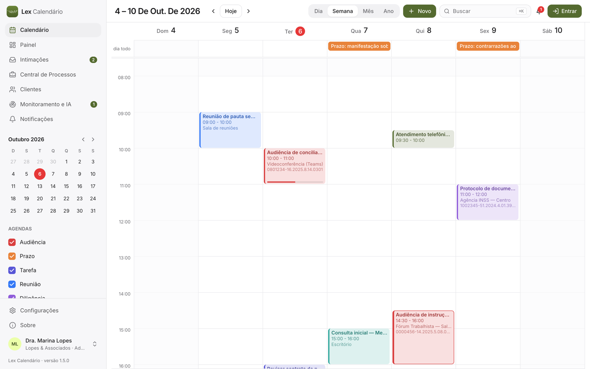
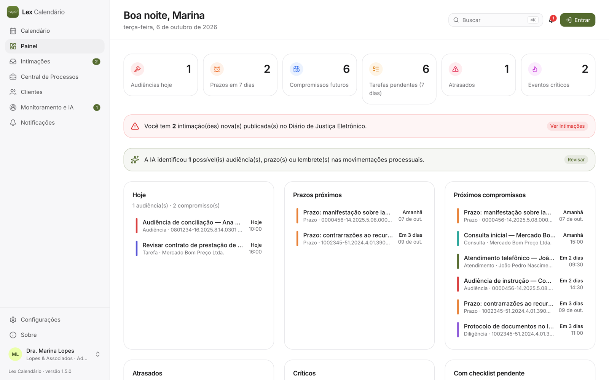
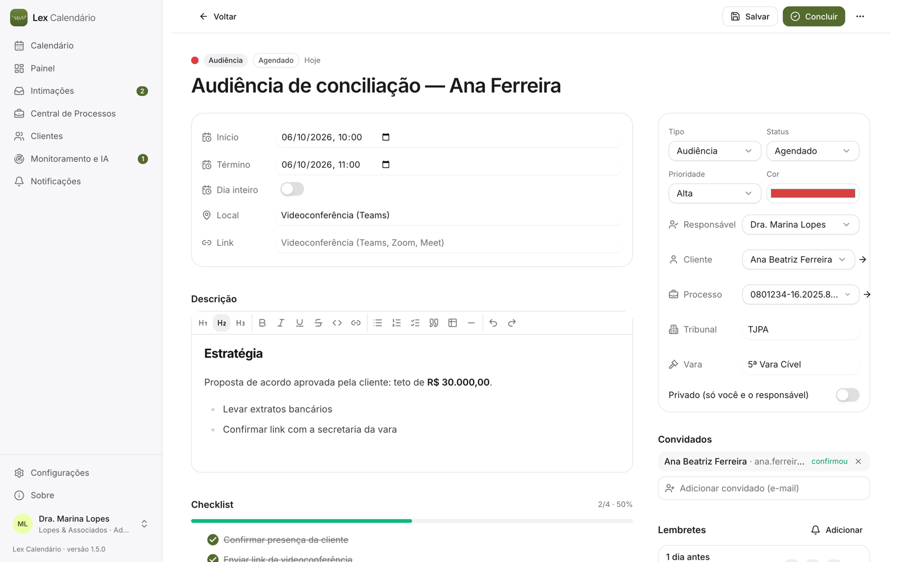
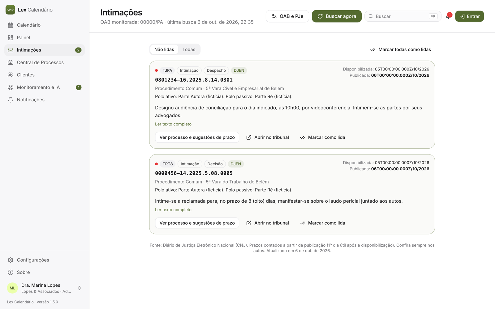
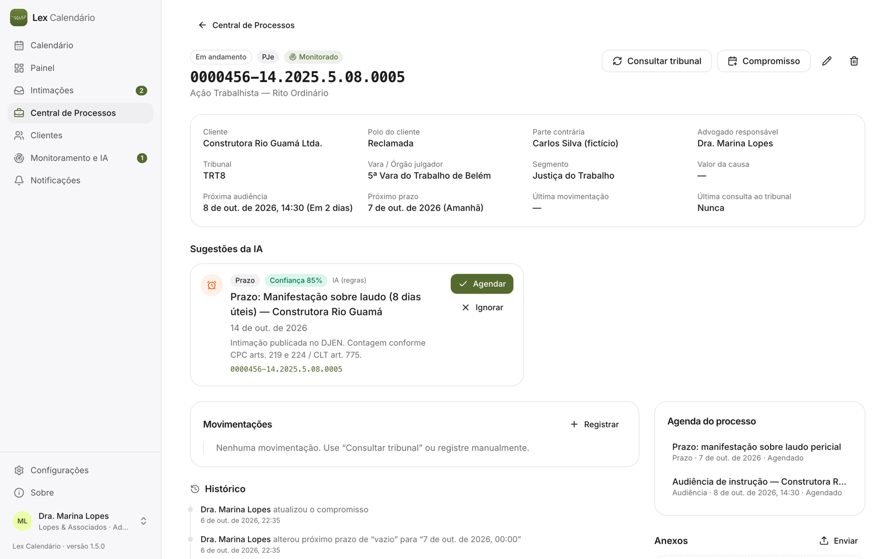
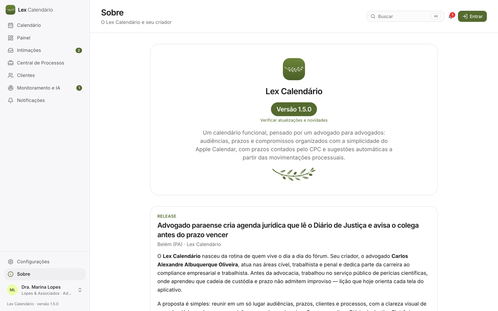

# Lex Calendário

**Calendário jurídico gratuito para advogados e escritórios de advocacia.**

Audiências, prazos contados pelo CPC, intimações do Diário de Justiça Eletrônico (DJEN) e processos, tudo num calendário simples.
Funciona **sem conta** e **sem internet**: os seus dados ficam no seu computador.

### [⬇️ Baixar a versão mais recente](https://github.com/oliveiracarlosadv/Lex-Calendario/releases/latest)

---

## Como instalar

Abra a página [**Baixar a versão mais recente**](https://github.com/oliveiracarlosadv/Lex-Calendario/releases/latest) e escolha o instalador do seu computador:

| Sistema | Arquivo |
|---|---|
| 🪟 Windows 10/11 | `LexCalendario-Instalador-Windows.exe` |
| 🍎 Mac com chip M1, M2, M3 ou M4 | `LexCalendario-Instalador-macOS-AppleSilicon.pkg` |
| 🍎 Mac com processador Intel | `LexCalendario-Instalador-macOS-Intel.pkg` |
| 🐧 Linux (Ubuntu, Debian, Mint) | `LexCalendario-Instalador-Linux.deb` |

Dê dois cliques no arquivo baixado e siga o assistente: **Avançar, Avançar, Concluir**. O Lex abre direto no calendário.

- **Windows:** se aparecer "O Windows protegeu o computador", clique em *Mais informações* → *Executar assim mesmo*.
- **Mac:** não sabe qual é o seu? Menu  → *Sobre Este Mac*. Se aparecer "Chip Apple", use o AppleSilicon; se aparecer "Processador Intel", use o Intel.

**Atualizar:** baixe o instalador novo e abra-o, ou use *Configurações → Aplicativo → Atualizar a partir do arquivo*. O Lex faz um backup antes e mantém os seus dados.

## Telas

| Calendário | Painel |
|:-:|:-:|
|  |  |
| **Compromisso** | **Intimações (DJEN)** |
|  |  |
| **Processo** | **Sobre** |
|  |  |

Dados fictícios de demonstração.

## O que o Lex faz

- Calendário de audiências, prazos, tarefas e compromissos, com cores por categoria.
- Prazos contados em dias úteis, pelo CPC.
- Busca de intimações pelo número da OAB no Diário de Justiça Eletrônico Nacional (CNJ).
- Cadastro de processos e clientes, com histórico.
- Sincronização opcional com o Google Agenda: o botão "Entrar" serve só para isso.
- Sugestões de prazos por inteligência artificial local e gratuita (Ollama), se você quiser.

## Uso gratuito

O Lex Calendário é gratuito para qualquer pessoa usar. O código-fonte não é público.

[Política de Privacidade](PRIVACIDADE.md) · [Termos de Uso](TERMOS.md)

© 2026 Carlos A. A. Oliveira
